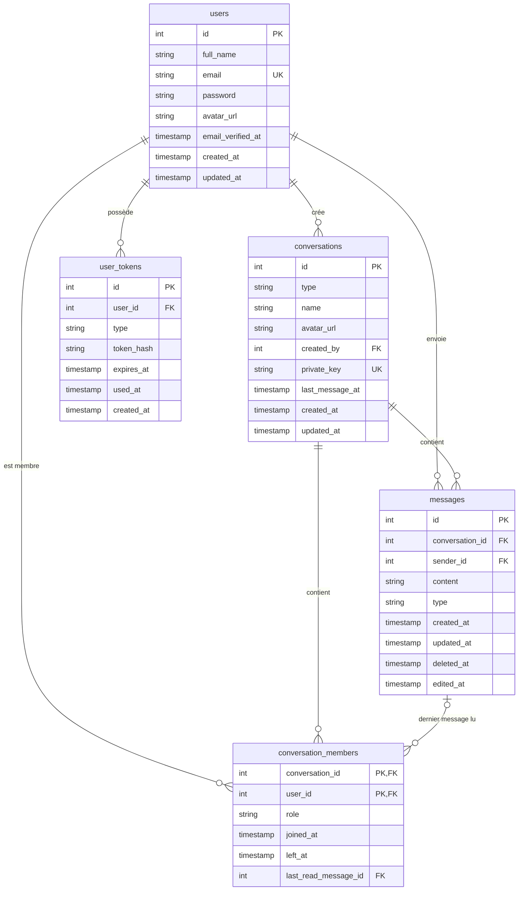

# Kadea Chat

Kadea Chat est une application de messagerie accessible depuis un navigateur. Les utilisateurs échangent en privé ou en groupe, reçoivent leurs messages en temps réel sans recharger la page, et retrouvent leurs conversations à chaque connexion.

Projet réalisé pour Kadea Academy, dans le cadre du capstone de la formation développeur web, avec AdonisJS 7, Edge et PostgreSQL.

**Site hébergé :** https://kadea-chat-fullstack.onrender.com

> Le site est hébergé sur Render. Si la formule gratuite est utilisée, la première page peut mettre environ une minute à s'afficher après une période d'inactivité.

---

## Technologies

| Rôle                          | Outil                                                                                |
| ----------------------------- | ------------------------------------------------------------------------------------ |
| Framework back-end            | AdonisJS 7 (TypeScript)                                                              |
| Vues                          | Edge (layouts et composants)                                                         |
| Base de données               | PostgreSQL, avec l'ORM Lucid                                                         |
| Temps réel                    | Transmit (Server-Sent Events), canaux privés                                         |
| Interactivité côté navigateur | Alpine.js                                                                            |
| Validation                    | VineJS (messages en français)                                                        |
| E-mails                       | AdonisJS Mail : SMTP en développement, API Brevo en production                       |
| Images de profil              | Cloudinary                                                                           |
| Style                         | CSS maison basé sur des variables (thèmes clair et sombre), police Plus Jakarta Sans |
| Hébergement                   | Render (service web et base PostgreSQL)                                              |

---

## Fonctionnalités réalisées

### Comptes utilisateurs

- Création de compte (nom, adresse e-mail, mot de passe)
- E-mail de confirmation avec un lien à usage unique, valable 24 heures
- Connexion refusée tant que l'adresse e-mail n'est pas confirmée
- Connexion et déconnexion
- Réinitialisation du mot de passe par e-mail
- Modification du profil : nom, photo de profil (type et taille vérifiés) et mot de passe (l'ancien est demandé)
- Recherche d'un utilisateur par son nom pour démarrer une conversation

### Conversations privées

- Démarrer une conversation avec un autre utilisateur (une seule conversation privée par paire d'utilisateurs)
- Liste des conversations avec le dernier message et sa date, triée de la plus récente à la plus ancienne
- Historique complet d'une conversation
- Accès refusé (erreur 403) à une conversation dont on ne fait pas partie

### Messages

- Envoi de messages texte, avec l'auteur et l'heure, sans rechargement de la page
- Réception en temps réel, sans actualiser la page
- Messages conservés après un rechargement ou une reconnexion
- Suppression d'un message envoyé, avec une indication à sa place, visible en temps réel
- Modification d'un message envoyé, avec la mention « (modifié) », visible en temps réel

### Groupes

- Création d'un groupe avec un nom et plusieurs membres
- Échange de messages en temps réel entre les membres
- Seuls les membres peuvent lire les messages du groupe
- L'administrateur (le créateur) peut ajouter ou retirer des membres
- Un membre peut quitter le groupe (l'administrateur ne peut pas le quitter)
- Les changements de membres sont répercutés en temps réel

### Fonctionnalités avancées

- **Statut des messages** : ✓ envoyé, ✓✓ lu (dans un groupe, quand tous les autres membres l'ont lu), dans la conversation et devant l'aperçu de la liste
- **Messages non lus** : pastille avec le nombre dans la liste, date et aperçu mis en évidence, total sur l'icône « Discussions » et dans le titre de l'onglet
- **Présence et saisie** : pastille verte « en ligne » pour les contacts d'une conversation privée, indication « écrit… » dans une bulle
- **Recherche dans les messages** : recherche d'un mot dans toutes ses conversations, avec extrait surligné ; le résultat ouvre la conversation au bon message

### Interface

- Identité visuelle propre à Kadea Chat (bleu nuit, thèmes clair et sombre)
- Ordinateur : colonne de navigation, liste des conversations à gauche et discussion à droite
- Téléphone : un écran à la fois, barre de navigation flottante en bas, bouton rond pour démarrer une discussion
- Page d'accueil de présentation, pages d'erreur en français, messages de validation en français

### Sécurité

- Mots de passe hachés
- Validation des données côté serveur (VineJS)
- Protection CSRF sur les formulaires et sur les abonnements temps réel
- Liens de confirmation et de réinitialisation : seul le hachage du jeton est stocké, avec une date d'expiration et un usage unique
- Droits vérifiés à chaque accès à une conversation, à chaque envoi, modification et suppression de message, à chaque recherche et à chaque abonnement temps réel
- Les messages sont affichés comme du texte (protection contre l'injection de code)
- Cookies de session sécurisés en production

---

## Ce qui n'est pas réalisé

- Partage de fichiers et d'images dans les messages
- Blocage d'un utilisateur
- Statut « reçu » (distinct de « envoyé » et « lu »)

---

## Installation et lancement en local

### Prérequis

- Node.js 20.6 ou plus récent
- PostgreSQL
- Un compte SMTP de test pour recevoir les e-mails de confirmation (par exemple Mailtrap)

### Étapes

```bash
# 1. Récupérer le code
git clone <url-du-depot>
cd <nom-du-dossier>

# 2. Installer les dépendances
npm install

# 3. Créer le fichier d'environnement
cp .env.example .env

# 4. Générer la clé de l'application et la copier dans APP_KEY (dans .env)
node ace generate:key
```

Crée ensuite une base de données PostgreSQL vide, puis renseigne le fichier `.env`. Pour un lancement en local :

```
NODE_ENV=development
HOST=localhost
APP_URL=http://localhost:3333
MAIL_MAILER=smtp
```

Puis :

```bash
# 5. Créer les tables
node ace migration:run

# 6. Lancer l'application
node ace serve --hmr
```

L'application est disponible sur http://localhost:3333. Les variables Cloudinary sont facultatives en local : sans elles, seul l'envoi de la photo de profil échoue.

---

## Variables d'environnement

Le fichier `.env.example` liste toutes les variables, sans valeurs secrètes.

| Variable                                                               | Rôle                                                                   |
| ---------------------------------------------------------------------- | ---------------------------------------------------------------------- |
| `TZ`                                                                   | Fuseau horaire du serveur (`Africa/Kinshasa`)                          |
| `PORT`                                                                 | Port d'écoute (`3333` en local ; défini par l'hébergeur en production) |
| `HOST`                                                                 | Adresse d'écoute (`localhost` en local, `0.0.0.0` en production)       |
| `NODE_ENV`                                                             | `development` ou `production`                                          |
| `LOG_LEVEL`                                                            | Niveau de journalisation (`info`)                                      |
| `APP_KEY`                                                              | Clé secrète de l'application (à générer avec `node ace generate:key`)  |
| `APP_URL`                                                              | Adresse publique du site, utilisée dans les liens des e-mails          |
| `SESSION_DRIVER`                                                       | Stockage des sessions (`cookie`)                                       |
| `DB_HOST`                                                              | Hôte de la base PostgreSQL                                             |
| `DB_PORT`                                                              | Port de la base (`5432`)                                               |
| `DB_USER`                                                              | Utilisateur de la base                                                 |
| `DB_PASSWORD`                                                          | Mot de passe de la base                                                |
| `DB_DATABASE`                                                          | Nom de la base                                                         |
| `MAIL_MAILER`                                                          | `smtp` (développement) ou `brevo` (production)                         |
| `MAIL_FROM_NAME`                                                       | Nom de l'expéditeur des e-mails                                        |
| `MAIL_FROM_ADDRESS`                                                    | Adresse de l'expéditeur (vérifiée chez Brevo en production)            |
| `SMTP_HOST`, `SMTP_PORT`, `SMTP_USERNAME`, `SMTP_PASSWORD`             | Identifiants du serveur SMTP                                           |
| `BREVO_API_KEY`                                                        | Clé d'API Brevo (production uniquement)                                |
| `CLOUDINARY_CLOUD_NAME`, `CLOUDINARY_API_KEY`, `CLOUDINARY_API_SECRET` | Identifiants Cloudinary pour les photos de profil                      |

---

## Base de données

Le dictionnaire de données, le MCD et le MLD sont disponibles ici : **[schémas draw.io](COLLE-ICI-LE-LIEN-DRAW-IO)**

Tables principales : utilisateurs, conversations, membres des conversations, messages, et jetons de confirmation et de réinitialisation.



Points de conception :

- **Un seul type de conversation** pour le privé et le groupe : un message appartient à une conversation, quelle que soit sa nature.
- **`private_key`** (par exemple `3:7`, les deux identifiants triés) est unique : il empêche deux conversations privées entre les mêmes personnes.
- **`conversation_members`** décide de l'accès : elle contient le rôle (`admin` ou `member`), `left_at` (rempli quand quelqu'un quitte un groupe ou en est retiré, ce qui conserve l'historique) et `last_read_message_id`, qui sert aux messages non lus et aux coches de lecture.
- **`deleted_at`** : un message supprimé n'est pas effacé, il est marqué, pour afficher l'indication à sa place. **`edited_at`** distingue une modification d'une simple mise à jour technique.

---

## Temps réel

Le serveur utilise Transmit (Server-Sent Events) avec deux sortes de canaux :

- **`conversations/:id/messages`** : nouveaux messages, suppressions, modifications, lectures, saisie en cours et changements de membres. L'abonnement est réservé aux membres de la conversation, avec la même règle que pour l'affichage de la page.
- **`users/:id`** : canal personnel, que seul son propriétaire peut écouter. Il sert à mettre à jour en direct la liste des conversations (nouveau message, nouvelle conversation, lecture).

La présence en ligne repose sur un signal envoyé toutes les 25 secondes et retenu en mémoire du serveur : elle fonctionne avec un seul serveur, et peut avoir jusqu'à une minute de retard.

---

## Déploiement

L'application est déployée sur Render, depuis la branche `main`.

- **Build :** `npm ci --include=dev && node ace build && cd build && npm ci --omit=dev`
- **Démarrage :** `cd build && node ace migration:run --force && node bin/server.js`
- Les variables d'environnement sont renseignées dans les réglages de l'hébergeur, pas dans le dépôt.
- En production, les e-mails passent par l'API de Brevo, parce que les services web gratuits de Render ne peuvent pas utiliser les ports SMTP.
- Les photos de profil sont stockées chez Cloudinary, parce que le disque d'un service Render est effacé à chaque déploiement.

---

## Auteur

Barthélemy Nsiala
